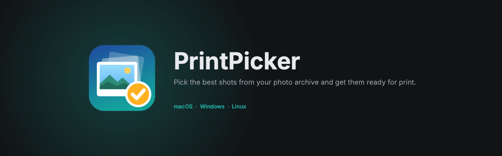
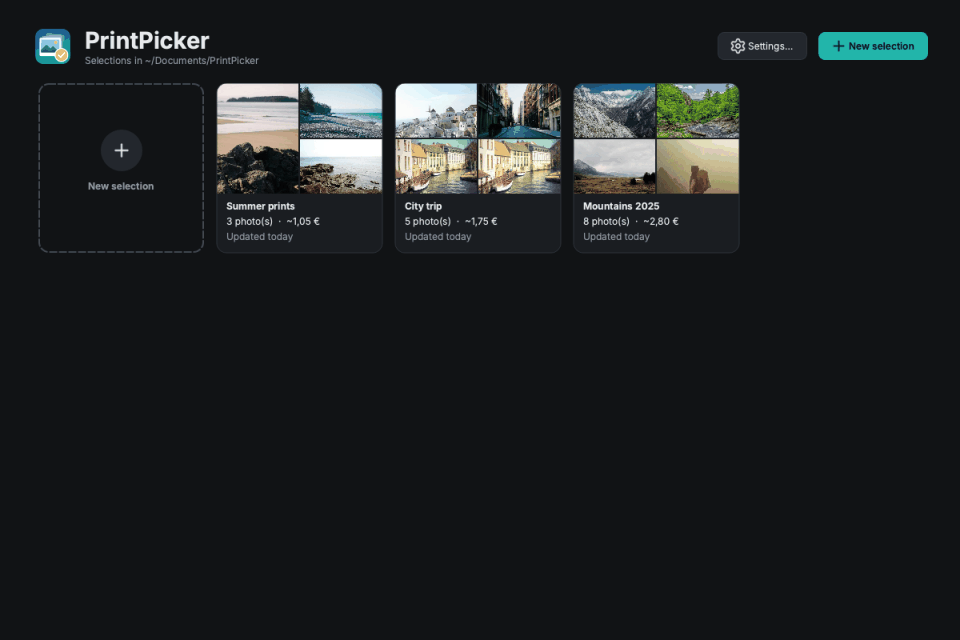
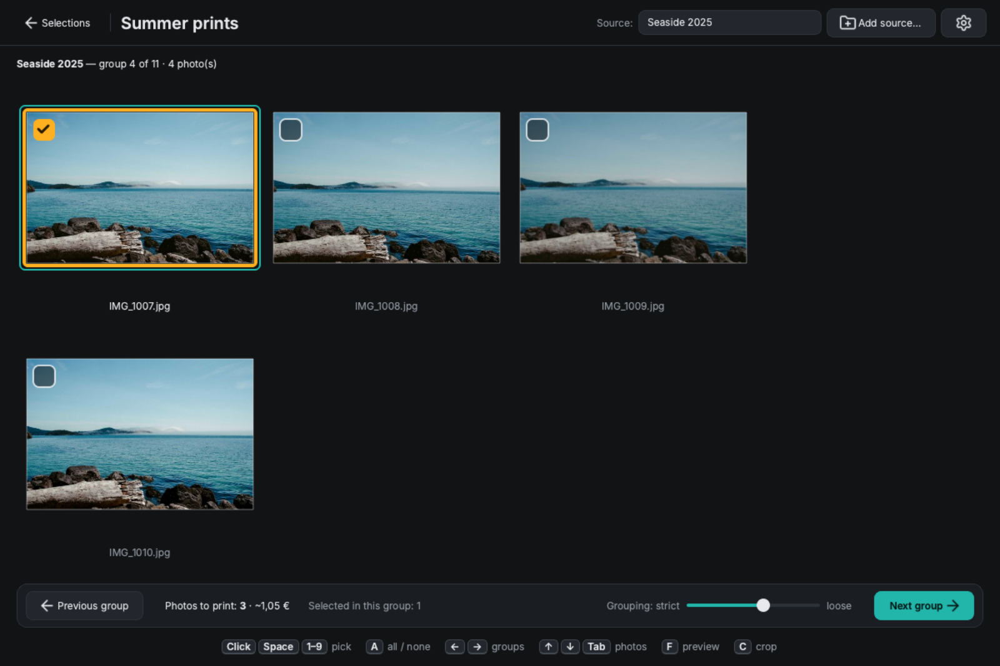
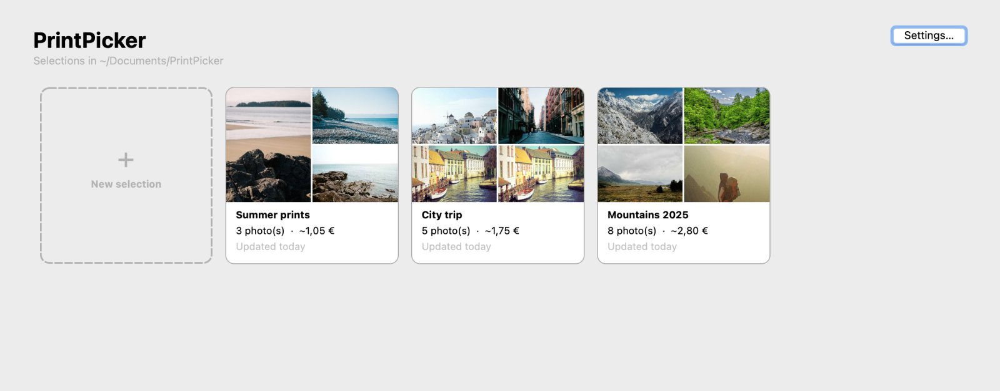
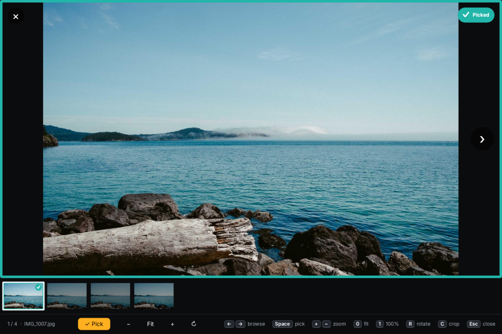
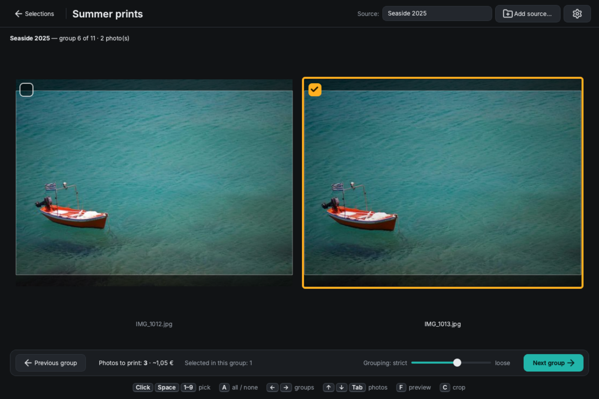
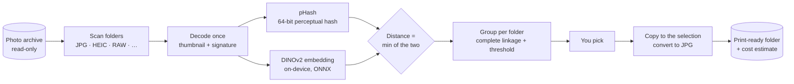

<p align="center">
  
</p>

<p align="center">
  <a href="https://github.com/GiacomoGuaresi/PrintPicker/actions/workflows/ci.yml"></a>
  <a href="https://github.com/GiacomoGuaresi/PrintPicker/releases/latest"></a>
  
  
  <a href="LICENSE"></a>
</p>

<p align="center">
  <a href="#download"><b>Download</b></a> ·
  <a href="#how-to-use-it">How to use it</a> ·
  <a href="#how-it-works">How it works</a> ·
  <a href="docs/README.md">Docs</a>
</p>

PrintPicker is a small cross-platform desktop app for people who keep their photos on an external drive, organized in folders. Point it at a folder and it walks you through **groups of visually similar photos**, one at a time: pick the best shots, and they're copied into a print-ready folder on your computer, with a running estimate of what the print order will cost.

<p align="center">
  
</p>

## Features

- **Similar-photo groups** — photos of the same scene are grouped together, so bursts, near-duplicates and shots retaken with another framing, orientation or light are shown side by side and you pick the best one(s). Grouping uses perceptual hashing plus a small on-device AI model ([DINOv2](https://github.com/facebookresearch/dinov2)): your photos never leave your computer.
- **Fast review** — click a photo to pick or unpick it (each one has a checkbox), ← → to move between groups: your picks are saved as you go, also when going back.
- **Live similarity threshold** — a slider regroups photos on the fly, from strict to loose.
- **Full-screen preview** with zoom and rotation to check focus and closed eyes, a filmstrip of the group and on-screen controls; neighbouring photos are preloaded for instant browsing — view only, files are never altered.
- **Crop preview** — warns when a photo's aspect ratio doesn't match the print format (3:2 for 10×15) and shows what will be printed.
- **Print selections** — each selection is a self-contained folder: the chosen photos plus a hidden `.printpicker/` folder with its database and thumbnails. Delete the folder after printing and nothing is left behind.
- **Resume anytime** — reopen a selection and continue from the first group you haven't seen.
- **Multiple sources per selection**, with graceful handling of disconnected or remapped drives.
- **Print-ready output** — flat folder, file names prefixed with their source path, HEIC/RAW/TIFF/WebP converted to JPG.
- **Cost estimate** — configurable tiered price list (PhotoSì 10×15 prices by default) with a live total.
- **Never touches your archive** — read-only on the source, always.
- **Private by design** — everything runs on your computer. The only network request is the optional daily update check to GitHub.
- **Native feel** — one dark theme on every platform, full keyboard control, menus where your OS expects them, English and Italian.

<table>
  <tr>
    <td width="50%"></td>
    <td width="50%"></td>
  </tr>
  <tr>
    <td align="center">Pick the best shots of each group</td>
    <td align="center">Print selections</td>
  </tr>
  <tr>
    <td></td>
    <td></td>
  </tr>
  <tr>
    <td align="center">Full-screen preview</td>
    <td align="center">Crop preview</td>
  </tr>
</table>

<sub>Sample photos from <a href="https://unsplash.com">Unsplash</a> via <a href="https://picsum.photos">Lorem Picsum</a>.</sub>

Supported formats: JPG, PNG, HEIC, RAW (CR2, NEF, ARW, DNG, …), TIFF, WebP. Videos are ignored.
Interface in English and Italian (follows the system language).

## Download

Get the latest build for your system from the [Releases](https://github.com/GiacomoGuaresi/PrintPicker/releases/latest) page:

| System | File |
|---|---|
| macOS (Apple Silicon) | [`PrintPicker-macos-arm64.dmg`](https://github.com/GiacomoGuaresi/PrintPicker/releases/latest/download/PrintPicker-macos-arm64.dmg) |
| Windows (64-bit) | [`PrintPicker-windows-x64-setup.exe`](https://github.com/GiacomoGuaresi/PrintPicker/releases/latest/download/PrintPicker-windows-x64-setup.exe) (installer) or `PrintPicker-windows-x64-portable.zip` |
| Linux (x86-64) | [`PrintPicker-linux-x86_64.AppImage`](https://github.com/GiacomoGuaresi/PrintPicker/releases/latest/download/PrintPicker-linux-x86_64.AppImage) or `PrintPicker-linux-x64.tar.gz` |

The builds are not signed, so the first launch needs one extra step:

- **macOS** — open the `.dmg`, drag `PrintPicker.app` to Applications, then right-click it and choose **Open** (or run `xattr -dr com.apple.quarantine /Applications/PrintPicker.app`).
- **Windows** — run the installer (no admin rights needed; it adds PrintPicker to the Start menu and to *Installed apps* for uninstalling). If SmartScreen appears, click **More info → Run anyway**. The portable zip runs without installing: unzip and start `PrintPicker.exe`.
- **Linux** — make the AppImage executable (`chmod +x PrintPicker-linux-x86_64.AppImage`) and run it. Alternatively extract the tar.gz and run `PrintPicker/PrintPicker`; `PrintPicker/install-desktop-entry.sh` adds it to the application menu.

`SHA256SUMS.txt` on the release page lists the checksums of every file.

PrintPicker tells you when a new version is out (*Help → Check for updates…*, or automatically once a day — you can turn it off in *Settings*).

## How to use it

1. **Create a print selection.** The start screen shows your selections as cards (cover, photos, estimated cost, last change). Click *New selection* and give it a name (e.g. `Print 2026-10-12`): it becomes a folder in `Documents/PrintPicker/`. The **⋯** button on a card (or a right click) opens, renames or deletes a selection.
2. **Add a source.** Choose a folder of your archive (sub-folders included). The first analysis reads every photo once — on a USB stick about 2 minutes for 500 photos — then it is cached.
3. **Review the groups.** Each screen shows one group of similar photos from the same folder. Click the photos to pick (none, one or more), then go to the next group with → or *Next group*: the picked photos are copied into the selection. Going back with ← keeps your picks too.
4. **Check the total.** The bottom bar shows how many photos you picked and the estimated cost.
5. **Print.** Open the selection folder, upload the photos to your print service, and delete the folder when you're done.

### Keyboard

| Key | Action |
|---|---|
| Click | Pick / unpick a photo |
| → or Enter | Next group (picks are saved) |
| ← or Backspace | Previous group (picks are saved) |
| ↑ ↓, Tab | Move between the photos of the group |
| Space, `1`–`9` | Pick / unpick the current (or n-th) photo |
| `A` | Pick all / none |
| `F`, double-click or the expand button on the photo | Full-screen preview |
| `C` | Hide / show the crop preview (on by default) |

In the full-screen preview: ← → to browse, Space to pick, `+` / `−` / mouse wheel to zoom, `0` fit, `1` 100%, double-click to switch between fit and 100%, `R` / `Shift+R` rotate, `Esc` to close. With the mouse: the arrows and the close button appear when you move it, the bottom bar has *Pick*, zoom and rotate buttons, and a click on the filmstrip jumps to that photo.

Anywhere: `Ctrl/⌘+N` new selection, `Ctrl/⌘+,` settings.

### Price list

*Settings…* holds the folder where selections are created and the price list used for the estimate: price tiers (the tier reached prices *all* the photos, as with PhotoSì quantity discounts) and fixed costs such as shipping.

## How it works



- **Two complementary signals.** A perceptual hash catches copies and near-identical bursts; a small vision model ([DINOv2](https://github.com/facebookresearch/dinov2) ViT-S/14, 44 MB, run with ONNX Runtime on the CPU) recognises the *same scene shot again* — reframed, rotated, in other light. Their distances share one scale, so the threshold slider stays meaningful.
- **Measured, not guessed.** A benchmark on sample photos with ground truth (`scripts/eval_grouping.py`) picked the method: pHash alone found 55% of the same-scene pairs on the hard cases, pHash + DINOv2 finds all of them with no false merges. Details in [architecture](docs/architecture.md).
- **Fast on slow drives.** Each photo is read once, decoded in parallel, and its signature and thumbnail are cached in the selection, so reopening is instant.

## Run from source

Requires [uv](https://docs.astral.sh/uv/).

```sh
git clone https://github.com/GiacomoGuaresi/PrintPicker.git
cd PrintPicker
uv sync
uv run python -m printpicker
```

Tests, lint, translations and builds are described in [docs/development.md](docs/development.md).

## Tech stack

Python + Qt ([PySide6](https://doc.qt.io/qtforpython-6/)), [Pillow](https://python-pillow.org/), [NumPy](https://numpy.org/), [pillow-heif](https://github.com/bigcat88/pillow_heif), [rawpy](https://github.com/letmaik/rawpy), [ONNX Runtime](https://onnxruntime.ai/). Packaged with PyInstaller and released by GitHub Actions for macOS, Windows and Linux. Icons by [Lucide](https://lucide.dev), typeface [Inter](https://rsms.me/inter/).

## Documentation

The full specification (in Italian) lives in [`docs/`](docs/README.md):

- [Overview](docs/overview.md)
- [Print selections](docs/selections.md)
- [Similar-photo grouping workflow](docs/grouping-workflow.md)
- [Copy and export](docs/export.md)
- [Print cost estimate](docs/cost-estimate.md)
- [Architecture](docs/architecture.md)
- [Roadmap](docs/roadmap.md)
- [Development and testing](docs/development.md)
- [Open questions](docs/open-questions.md)

## Contributing

Bug reports, ideas and pull requests are welcome — see [CONTRIBUTING.md](CONTRIBUTING.md). The quickest way to report a problem is *Help → Report a problem…* in the app: it opens an issue with your version and system already filled in.

## License

[MIT](LICENSE) © 2026 Giacomo Guaresi

The bundled grouping model, DINOv2 ViT-S/14 by Meta AI, is distributed under the [Apache License 2.0](https://www.apache.org/licenses/LICENSE-2.0) (see [NOTICE](src/printpicker/resources/models/NOTICE.md)). [Lucide](https://lucide.dev) icons: ISC License. [Inter](https://rsms.me/inter/) typeface: SIL Open Font License 1.1.
